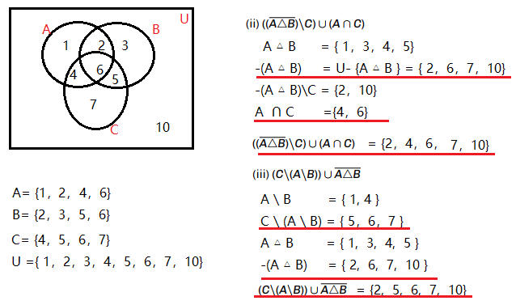

# 1. 语法
## 1.1 Comprehension(推导式)  
### 1.1.1 dict推导式写法
 ```python
    user_status = {"Alice": "active", "Bob": "inactive", "Charlie":"active", "David": "expired"}
    active_users = {user: status for user, status in user_status.items() if status == "active"}
    
    # Output: {'Alice': 'active', 'Charlie': 'active'}

    # 1. Start with the loop:               for user, status in user_status.items()
    # 2. Apply the filter(过滤条件，可选):   if status == "active"
    # 3. Produces a value:                  user: status
    # 4. Append value to dict:              user: status -> {}    
```  

### 1.1.2 过滤条件是if和if else时的不同写法
 ```python
    # 没有else时的过滤条件，放for后面
    data = [v  for v in list1 if v %2 ==0]

    # 存在else时的过滤条件，放for前面，for后面空着
    data = [v if v %2 ==0 else 0 for v in list1 ]
```  

## 1.2 注释
 ```python
    # 这是单行注释

    """
     这是多行注释
    """
```  

---  

# 2. 容器
## 2.1 Dict
### 2.1.1 遍历
```python
    for k,v in dict1.items():
        print(k,y)
```

### 2.1.2 按字段汇总(sum)
|Region|Sale|Week |
| --- | --- | --- |
|Reg A|11|1|
|Reg A|23|2|
|Reg B|7|1|
|Reg C|17|2|

> 按区域汇总2周的销售量

```python
    region = {}
    for aline in inFile:
        data = aline.strip().split()

        # key: Region  value: sum(sale)
        region[data[0]] = region.get(data[0],0) + data[1]
```

### 2.1.3 key-value中的value放容器而不是值
```python
    # 放list
    phone_list = region.get("lxy_phone",[])
    pohne_list.append( new_phone )
    region["lxy_phone"] = pohne_list

    # 放dict
    region_parts = region.get("region",{})
    # data[1]: part_type      data[2]: part_number          
    region_parts[ data[1] ] = region_parts.get(data[1],0) + data[2]
    region["lxy_phone"] = region_parts

```

## 2.2 Set
### 2.2.1 利用set来解数据问题

```python
A = {1,2,4,6}
B = {2,3,5,6}
C = {4,5,6,7}
U = {1,2,3,4,5,6,7,10}

# (-(A △ B)\C) ∪ （ A ∩ C )
notAB  = U.difference(A.symmetric_difference(B))
result = notAB.difference(C).union(  A.intersection(C) )
print(result)
# output :{2, 4, 6, 10}

```

---  

# 3. File
## 3.1 打开文件的外面要加异常保护
 ```python
    try:
        with open("path/to/thefile.txt", "r") as infile:
            # read file contents
            # file closes automatically when we exit block     
    except:
        print("file error!")
``` 

## 3.2 跳过一行读取
```python
    next(inflile)
```     

## 3.3 跳过注释行
```python
    for aline in inFile:
        if aline.lstrip().index('#')== 0:
            continue

        # 非注释行处理
```     

## 3.4 文件格式检查
```python
    for aline in inFile:
        data = aline.split(",")

        # 检查宽度
        if width != len(data):
            print("invalid width")
            break

        # 检查数据值
        for v in data:
            if ( v<0 and v > max_gray_value)
                print("invalid pixel value")
                break
        else:
            continue
        
        break
    else:
        print("valid  image")      
```     
## 3.5 追加写入文件内容
 ```python
    try:
        with open("path/to/thefile.txt", "a") as infile:
            # read file contents
            # file closes automatically when we exit block     
    except:
        print("file error!")
``` 