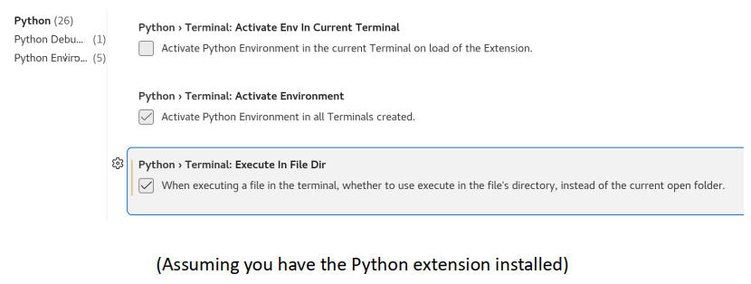

# Outline
|循环类型|何时终止循环|判断条件位置|
|---|---|---|
|while| while_condition == false|开头|
|do while| while_condition == false|结尾|
|for| index/value not in list |开头|
---  
  

# 1. while(遇假结束，判断条件前置)
## 1.1 通用while语法
```python
    while logical_expression:  

        if continue_condition:
            continue          # 跳转到while开头继续执行，continue后面循环内的语句不执行

        Statements to execute 

        if break_condition:
            break            # 中断循环

```
    •   当逻辑表达式变为False时，循环结束

    •   循环内的所有语句必须具有相同的缩进级别  
    
## 1.2 While-else语法(很少使用)
Python 的 `while...else` 是一个非常独特的语法结构，核心规则是：
> **1. while循环正常结束或没有循环后，执行else中语句  
> 2. 如果用break中断循环，不执行else中语句。**

---

### 例子：遍历查找目标元素
比如我们要在一个列表中查找第一个大于 100 的数字，如果遍历完所有元素都没找到，就走 `else` 提示未找到：
```python
nums = [12, 45, 67, 89, 33, 76]
target = 100
i = 0
while i < len(nums):
    if nums[i] > target:
        print(f"找到第一个大于{target}的数：{nums[i]}，索引是{i}")
        break  # 找到目标，提前退出
    i += 1
else:
    # 循环走完所有元素都没找到，执行这里
    print(f"列表中所有元素都小于等于{target}")

# 测试
# 输出：列表中所有元素都小于等于100（循环自然结束，执行else）

# 如果把列表改成 [12, 45, 103, 67]，target还是100
# 输出：找到第一个大于100的数：103，索引是2（break触发，不执行else）
```

---

### 关键注意点
#### 1. 只有 `break` 会阻止 `else` 执行
`continue` 只是跳过当前迭代，不会退出循环，只要循环最终是自然结束的，`else` 依然会执行：
```python
i = 0
while i < 5:
    i += 1
    if i == 3:
        continue  # 跳过本次迭代，不影响循环整体结束逻辑
    print(i)
else:
    print("循环正常结束，执行else")
# 输出：
# 1
# 2
# 4
# 5
# 循环正常结束，执行else
```

#### 2. 循环一次都没执行也会走 `else`
如果 `while` 的初始条件就是 `False`，循环体不会运行，但依然属于「自然结束」，`else` 会正常执行：
```python
count = 0
while count > 5:
    print(count)
    count += 1
else:
    print("条件一开始就不满足，循环没执行，但else依然会跑")
# 输出：条件一开始就不满足，循环没执行，但else依然会跑
```

#### 3. 不要和 `if else` 混淆
`else` 是和 `while` 对齐的，属于循环控制语法，不是 `if` 的附属分支，新手很容易写错缩进导致逻辑异常。
  

# 2. do while(遇假结束，判断条件后置)
## 2.1 通用while语法
```python
    do:
        Statements to execute 

        if continue_condition:
            continue          # 跳转到do继续执行，continue后面循环内的语句不执行

        if break_condition:
            break            # 中断循环

    while logical_expression:              
```
    •   当逻辑表达式变为False时，循环结束

    •   循环内的所有语句必须具有相同的缩进级别  
    

  # 3. for(index/value not in list，判断条件前置) 
  ## 3.1  通用for语法
```python
    # 按索引范围遍历循环 
    for index int Range(start ,stop, step)   # [start,stop)

        if continue_condition:
            continue          # index +=step, 跳转到while开头继续执行，

        Statements to execute 

        if break_condition:
            break            # 中断循环

    # 按容器内容遍历循环 
    for index int container   # container: list/tuple/set/dict/string

        if continue_condition:
            continue          # index +=step, 跳转到while开头继续执行，

        Statements to execute 

        if break_condition:
            break            # 中断循环
```

  ## 3.2 按索引范围遍历循环 
```python
  for k in range(4):

    Statements to execute
```
### Range(start, stop, step)  
    • from start
    • up to (but not including) stop
    • in increments of step 
    • 从start开始循环，直到遇到stop结束（但不包括stop)，每次循环增加step（可正可负)
    • Range()返回的其实是一个list:  [start ....   stop(不包含stop) ]

## 3.3 按容器内容遍历循环 
```python  
    # 遍历list中的每一个string
    animals = ['dog', 'cat', 'hamster', 'goldfish']
    for item in animals:  # in 后面可以跟list,tuple,set,dict，string
        print(item)

    # 遍历string中的每一个char
    course = "Computer Science" #把course看成是char的list
    for ch in course:
        print(ch)        
```        
### in关键字
    • in关键字从容器中（常用容器可以是list,tuple,set,dict,string)提取一个value
    • 配合for，可用于遍历容器中的每一个value
    • 当容器中的所有value遍历完(即 v in 容器 == false)，循环结束


# 4. Comprehension(推导式)  

    • 对列表、集合、字典、文件等对象进行遍历以生成数据结构，是非常常见的编程任务。
    • Python 为此提供了一种专用的语法结构，叫做Comprehension(推导式)。
    • Comprehension是一种简洁易读的方式，仅用单行表达式即可从任意可迭代对象创建出对应的数据结构。

## 4.1  Comprehension语法    
```python
    expression for item in iterable-thing if condition

    # for-item in iterable thing从任何支持迭代的对象中检索值（例如list,set,dict,file）  

    # if条件（可选）可用于过滤检索到的值

    # expression生成一个值，用于新结构.

   #  这三个组件被括在[]中以生成列表，{}用于生成集合或字典    

```  

## 4.2  How to build a comprehension?
### 4.2.1 list的例子：将animals中不等于goldfish的动物，保存到新list: not_fish中
 ```python
    animals = ['dog', 'cat', 'hamster', 'goldfish']
    not_fish = [item for item in animals if item != 'goldfish']

    # 1. Start with the loop:               for item in animals

    # 2. Apply the filter(过滤条件，可选):   if item != 'goldfish'
    
    # 3. Produces a value:                  item  
    
    # 4. Append value to list:              item -> []    
```   
### 4.2.2 set的例子：小写并去重字符串list
 ```python
    raw_subjects = ["Math", "science", "MATH", "History", "science"]
    clean_subjects = {s.lower() for s in raw_subjects}

    # Output: {'math', 'science', 'history'}

    # 1. Start with the loop:               for s in raw_subjects
    
    # 2. Apply the filter(过滤条件，可选):   None
    
    # 3. Produces a value:                  s.lower()
    
    # 4. Append value to set(set会去重):    s.lower()-> {}    
```   

### 4.2.3 dict的例子：将status==active的key-value pair保存到新dict中

 ```python
    user_status = {"Alice": "active", "Bob": "inactive", "Charlie":"active", "David": "expired"}
    active_users = {user: status for user, status in user_status.items() if status == "active"}
    
    # Output: {'Alice': 'active', 'Charlie': 'active'}

    # 1. Start with the loop:               for user, status in user_status.items()
    
    # 2. Apply the filter(过滤条件，可选):   if status == "active"
    
    # 3. Produces a value:                  user: status
    
    # 4. Append value to dict:              user: status -> {}    
```   

# 5. File and Path
>警告：由于工作目录不匹配，在某些IDE（如Codespace）中使用“运行”按钮可能会对外部文件产生**FileNotFoundError**。这是因为默认情况下，**“运行”按钮会从源文件所在的不同目录运行程序** 。
解决方法如下： 

 
 ## 5.1 Reading Data from a File（The Four Steps）
    1. Opening the file
    2. Reading data from the file object
    3. Processing & cleaning the data
    4. Closing the file  
   
 ### 5.1.1 Opening a File for Reading
    • To access the file contents, a file must be opened
    • This creates a file object which we can read from directly   

 ```python
    with open("path/to/thefile.txt", "r") as infile:
        # read file contents
        # file closes automatically when we exit block     
``` 

 ### File Objects
    • When we open a file, the open() function returns a file object 

    • The file object supports a set of methods that allow us to read data into our program in different ways 

    • File objects are iterable(可迭代的), so you can use a for loop to access data line-byline – making working with text files straightforward

 ### 5.1.2 Read Data from a File
|读取方法|说明|
|---|---|
|for line in file| 一次读一行|
|file.read()| 把整个文件读入到一个string|
|file.readlines()|读取剩余的全部内容，并将其作为字符串列表返回|

 ```python
with open("student_data.csv", "r") as infile:
    for line in infile:
        print(line)
``` 

 ### 5.1.3 Cleaning Data(数据整理)
  ```python
    #If we have a list of strings which looks something like:

    data = ['ID,Name,Mathematics,Science,History\n', '1001,Quinn Bell,53,51,88\n'…]

    # We might need to:
    #   • Remove the \n from the end
    #   • Split the strings up into individual words

    data = [line.strip().split(",") for line in data]

    # Recall the string methods:
    #   • strip() to remove the leading and trailing character \n
    #   • split(",") to split a string into individual words using "," separator
``` 

 ### 5.1.4 Read in data to Data Structure(数据结构)
    • 为了简单起见，我们专注于将数据读入list，因为这些list非常灵活，基本上可以用于任何数据   
    
    • 然而，有时你会发现使用dict或其他更专业的Data Structure(比如Stack，Queue)更有用  
    
    • 一旦你的程序中的数据具有合适的数据结构，你就可以使用你已经学到的任何东西来处理数据

 ## 5.2 Reading Data from a File（The Four Steps）    
    1. Open the file
    2. Ensure data is in the right format
    3. Write the data
    4. Close the file

 ### 5.1.1 Opening a File for Writing
 ```python
    with open("path/to/thefile.txt", "w") as outfile:
 ```

 |file open mode |operator|
 |---|---|
 |"r"|read|
 |"w"|write|
 |"a"|append|

### 5.1.2  Formatting the Data for Writing to a File

    当我们将数据写入文件时，我们需要考虑
    • 我们用这些数据做什么
    • 以及我们应该如何格式化它。

    它需要人类可读吗？
    它会被加载到另一个程序中吗？
    它需要遵循特定的格式吗？

### 5.1.3  Writing the Data to a File  
 ```python  
with open("path/to/thefile.txt", "w") as outfile:
outfile.write("Some literal text\n")
outfile.write(string_variable + "\n")
outfile.writelines(["this\n", "also\n", "works\n"])

# 记住字符串要加"\n"才能换行，否则在一行输出
 ```

### 5.1.4 Task4: Reading and Writing PGM images 


    Finish implementing all programs in the directory
    1 – Displaying a PGM image information
    2 – Validate a PGM image
    3 – Invert a PGM image
