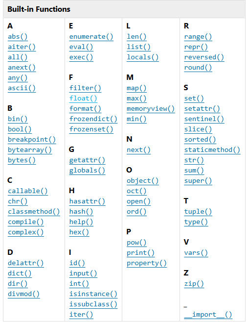
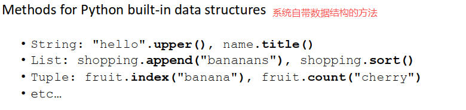
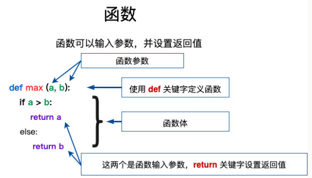
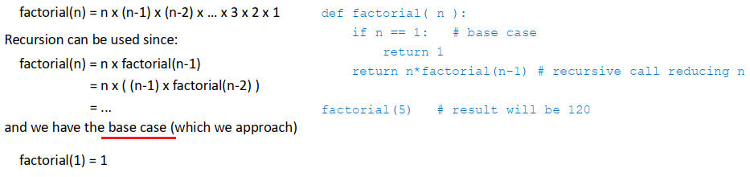
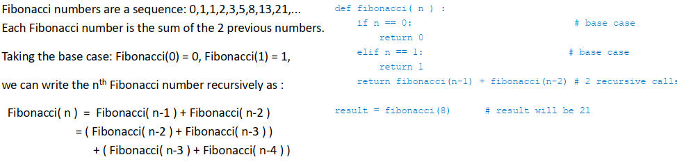

# 1. Function
## 1.1 Function Type
|Type| Desc|Demo|
|---| --- |--- |
|Built-in function| 系统自带函数|print – print("Hello world")<br>input – name=input("What is your name?")|
|Built-in methods| OOP对象的方法|str.lower()|
|User-Defined function|用户写的函数|def my_add(a,b):<br>    return a+b|
|Lamda functon|匿名函数|x = lambda a : a + 10<br>print(x(5))|

## 1.2 Build-in Function
  
https://docs.python.org/3/builtins/functions.html

## 1.3 Build-in Methods
  

## 1.4 User-Defined function
  

https://www.runoob.com/python3/python3-function.html

# 2. User-Defined function
## 2.1 函数调用
 ```python
def add_two_numbers(num1, num2): # defining the function
    return num1+num2              # (function environment)

result = add_two_numbers(3, 4)   # using the function
print(f'Result: {result}')       # (calling environment)
 ```

## 2.2 函数传递参数是byref还是byvalue？
|参数类型| 传递方法|效果|适用类型|
|---| --- |--- |--- |
|不可变类型（immutable）|ByVal |函数内修改参数值，不影响函数外变量|simple variables 、numerical values、string、Tuple|
|可变类型（mutable）|ByRef |函数内修改参数值，    影响函数外变量|所有其他类型|

 ```python
 # byref参数传递例子  
 def changeme( mylist ):
   mylist.append([1,2,3,4])  # 修改传入的列表
   return
 
# 调用changeme函数
mylist = [10,20,30]
changeme( mylist )
print ( mylist)             # [10, 20, 30, [1, 2, 3, 4]] mylist被修改
 ```  
 
 ## 2.3 Optional arguments(可选参数)
    可选参数： 

    • 在调用时可以不传入这个参数，不传入时用默认值代替

    • 语法是： 参数名 = 默认值  

### 例1：range( start=0, stop, step=1 )  
```python
def range( start=0, stop, step=1 )  
        #...

print(range(5))      # range(0,5,1)  output [0,1,2,3,4]
print(range(2,5))    # range(2,5,1)  output [2,3,4]    
print(range(2,5,2))  # range(2,5,2)  output [2,4]4]        
```  

### 例2：print(*objects, sep=' ', end='\n', file=None, flush=False)
```python
# 将对象打印到文本文件，用sep分隔，后跟end和flush。end、file和flush（如果存在）必须作为关键字参数给出
def print(*objects, sep=' ', end='\n', file=None, flush=False)
        #...   

# end的用法： output： 0:1:2:3:4:
for item in range(5):
    print(item, end=":")  

# file的用法
with open('output.txt', 'w', encoding='utf-8') as f:
    # 这里的一切 print 输出都会写入 f 指向的文件
    print('Hello, world!', file=f)              # 第1行
    print(42, file=f)                           # 第2行（会自动转成字符串）
    # 也可以一次性写入多个值，默认以,分隔
    print('年龄:', 25, '岁', file=f , sep=',')  # 第3行
```  

## 2.4 Return 
```python
# 没有返回值的函数
def  my_print(str)
    print(str)

# 有多个返回值的函数
def return_constants():
    PI = 3.14159
    GRAVITY = 9.81
    SPEED_OF_LIGHT = 299792458
    return PI, GRAVITY, SPEED_OF_LIGHT

# 这样获取返回值，返回值类型为tuple
constants = return_constants()
print( constants )   # (3.14159, 9.81, 299792458）

# 但这样获取返回值，返回值类型为3个double
pi, gravity, light_speed = return_constants()
print(pi, gravity, light_speed) # 3.14159, 9.81, 299792458
```


## 2.5 Recursive functions(递归函数)
### 2.5.1 Three golden rules
> • A recursive function must have a base case  
> • A recursive function must call itself (recursive case)  
> • The recursive case must approach(抵达) the base case

### 2.5.2 Type
|Type||Desc|
|---|---|---|
|linear recursion|线性递归|The function makes one recursive call to itself|
| tree recursion|树状递归|The function makes 2 (or more) recursive calls|

### 2.5.3 A simple example: factorial(n)
>linear recursion  ： 1 recursive case

   

### 2.5.4 A further example: fibonacci(n)
>tree recursion   ： 2 or more recursive case  

 

# 3. Lambda命名函数
> Python 使用 lambda 来创建匿名函数。
+ 所谓匿名，意即不再使用 def 语句这样准的形式定义一个函数。
+ lambda 只是一个表达式，函数体比 def 简单很多。lambda 的主体是一个表达式，而不是一个代码块。仅仅能在 lambda 表达式中封装有限的逻辑进去。

> lambda函数语法  

    lambda [arg1 [,arg2,.....argn]]:expression  

```python
x = lambda a : a + 10
print(x(5))                   # output 15

my_sum = lambda arg1, arg2: arg1 + arg2
print (my_sum( 10, 20 ))     # output 30
```