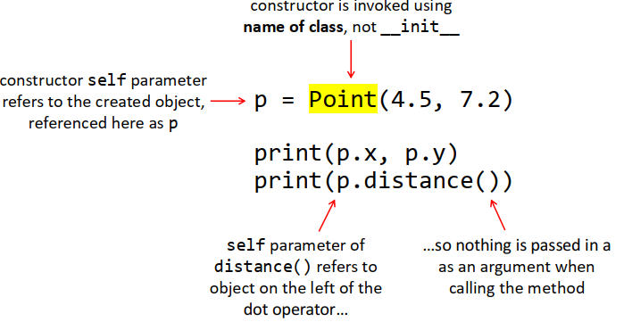
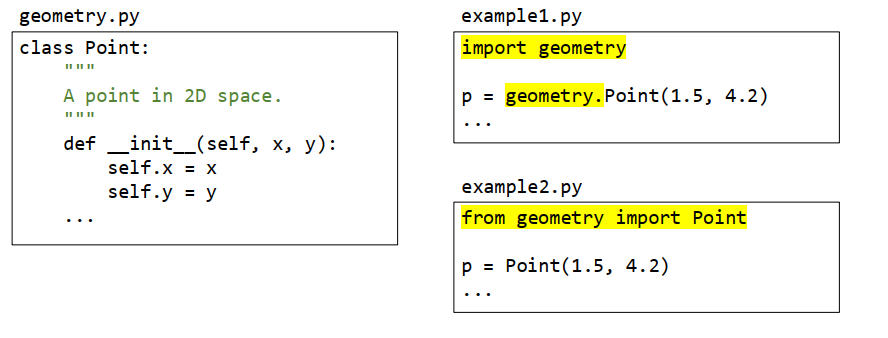
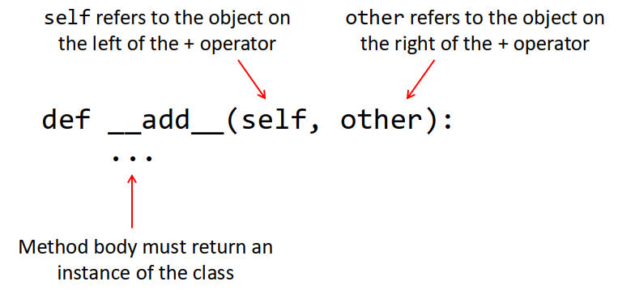

# 0. OOP规则
## 1. 定义新class
    规则如下：

    1. data和function必须写在类的内部
   
    2. constructor固定用def __init__(self,额外参数列表....):格式
   
    3. class的所有function第一个参数固定为classInstance，名字为self，格式如下：
        
        def  fun(self,额外参数列表....):
        
        • 特殊的self参数指的是“classInstance本身”，即fun当前所属的classInstance
        • self始终是参数列表中的第一个参数

    4. class的function内要访问 class的data和方法时，必须用classInstance.data和classInstance.fun()

    5. class的function内的变量如没加classInstance.，则该变量是普通变量，不是class的data
```python
class Point:

    # rule1: data和function写在类的内部
    x = 0
    y = 0

    # rule2： constructor固定用def __init__(self,额外参数列表....):格式
    def __init__(self, x, y):

        #rule4： class的function内要访问 class的方法时，必须用classInstance.fun()
        self.set_x(x)
        self.set_y(y)


    #rule3： class的所有function第一个参数固定为classInstance，名字为self
    def set_x(self, x):

        #• 特殊的self参数指的是“classInstance本身”，即fun当前所属的classInstance
        #• self始终是参数列表中的第一个参数

        #rule4： class的function内要访问 class的data时，必须用classInstance.data
        self.x = x

        #rule5： class的function内的变量如没加classInstance.，则该变量是普通变量，不是class的data
        y = 0  # 设置0的y是set_x函数的局部变量，class的y要用self.y访问
```
## 2. 使用class
    规则如下：

    1. class必须创建instance，才能存放data和调用function
   
    2. 访问class的data，语法是：instance.data

    3. 调用class的funcion，语法是：instance.fun(), 
       fun()内参数列表从第2个参数开始传，self参数忽略传送，由系统处理
   
```python
    # rule 1: class必须创建instance，才能存放data和调用function
    pt = Point(1,3)

    # rule 3： 调用class的funcion，语法是： instance.fun()
    #          fun()内参数列表从第2个参数开始传，self参数忽略传送，由系统处理
    pt.set_x(4) #()内从第2个参数x开始传

    # rule 2： 访问class的data，语法是：instance.data
    print(pt.x)

    

```


# 1. 传统的函数式编程 vs 现代面向对象编程OOP
    现代计算机图形需要用2D Point来进行各种图形运算。其中Point包含：
    Data： 
          float x,y; 

    Function:
          Print(pt)         // 打印Point对象
          Distance(pt1,pt2) // 计算距离

||函数式编程| OOP|
|---|---|---|
|**数据组织方式**|data和function是**分离的**|data和function**从属于更高级的class**|
||data<br>function|class Point{<br>&nbsp;&nbsp;&nbsp;&nbsp;data<br>&nbsp;&nbsp;&nbsp;&nbsp;function<br>}|
|**Data对象**|用**Record**包裹所有Data成员|用**class**包裹所有Data成员|
||**RECORD**  Point<br>&nbsp;&nbsp;&nbsp;&nbsp;float x,y;<br>ENDRECORD|**class** Point:<br>&nbsp;&nbsp;&nbsp;&nbsp;x=0.0<br>&nbsp;&nbsp;&nbsp;&nbsp;y=0.0|
|**访问Data对象前，先创建Instance**|Point recInstance = Point(1,4)| Point clsInstance = Point(1,4)|
|**访问Data成员，要通过Instance**|Data成员**包裹在Record中**，所以要用**Record Instance**来访问|Data成员**包裹在class中**，所以要用**class Instance**来访问 |
||Print(**recInstance**.x)|Print(**clsInstance**.x)|
|**Function**|**Function只包含代码逻辑，不包含数据**|**Function只包含代码逻辑，不包含数据**|
|**Function需要的数据，作为参数传入**|Data成员**包裹在Record中**，所以要把**整个Record Instance作为参数传入**|Data成员**包裹在class中**，所以要把**整个class Instance作为参数传入**|
||FUNCTION Print(Point **recInstance**)<br>&nbsp;&nbsp;&nbsp;&nbsp;print(**recInstance.x**)<br>ENDFUNCTION|class Point:<br>&nbsp;&nbsp;&nbsp;&nbsp;def print(**clsInstance**):<br>&nbsp;&nbsp;&nbsp;&nbsp;&nbsp;&nbsp;&nbsp;&nbsp;print(**clsInstance.x**)|
||FUNCTION Distance(Point **recInstance1**,Point **recInstance2**)<br>&nbsp;&nbsp;&nbsp;&nbsp;return recInstance1.x - recInstance2.x<br>ENDFUNCTION|class Point:<br>&nbsp;&nbsp;&nbsp;&nbsp;def distance(**clsInstance1**,**clsInstance2**):<br>&nbsp;&nbsp;&nbsp;&nbsp;&nbsp;&nbsp;&nbsp;&nbsp;return recInstance1.x - recInstance2.x|
|**调用Function**|**需要传入Data对象**作为Function的一个参数|**不需要传入Data对象**作为Function的一个参数|
||Print(**recInstance**)| **clsInstance**.print()<br><br>Python在编译时会替换为:<br>print(**clsInstance**)<br><br>**这就是python class的function第一个参数都是self的原因，它实际上是把clsInstance作为Data对象，插入到function参数列表的第1位**|
||Distance(**recInstance1,recInstance2**)| **clsInstance1**.distance(clsInstance2)<br>Python替换为:<br>distance(**clsInstance1**,clsInstance2)|

# 2. OOP设计
## 2.1 OOP设计：找到data和function
    无论是传统函数性编程，还是OOP编程，对于新的类型，描述都包含这两种东西：
    •   类型的data
    •   围绕data定义的相关function操作

    所以当题目要求创建一个class时，首先思考的就是：    
    •   这个class包含的data是什么？
    •   围绕class的data，需要提供的哪些function

>以Point，Circle、Student三个类举例说明，相关的data和function：  

||Point| Circle| Student |
|---|---|---|---|
|Data|x,y坐标|圆心坐标，半径|姓名,年级,学号|
|Function|打印<br>计算距离<br>...|打印<br>计算面积<br>...|打印<br>修改信息<br>...|

## 2.2 OOP设计：把data和function包裹在class里面
||Code|Desc |
|---|---|---|
|**定义新类型**|**class Point:**|定义一个叫Point的新类型|
|**定义data**|&nbsp;&nbsp;&nbsp;&nbsp;x = 0|把Point的所有data成员定义class Point里面|
||&nbsp;&nbsp;&nbsp;&nbsp;y = 0|x,y现在只能通过<b>classInstance.</b>来访问,<br>因为x,y在class内部，不能绕过class直接访问x,y|
|**定义function**||规则如下：<br>**•  function只包含代码逻辑，不包含数据<br>•   function所需数据由classInstance提供，并作为function的第一个参数self传入。<br>• function被包裹在class内部，所以不能直接访问，要用classInstance.fun()方式调用<br>•   调用时，用classInstance.fun(第2参数，第3参数)方式调用，第一个参数self不要传入参数，python会自动把classInstance作为第一参数传入**|
||&nbsp;&nbsp;def Print(**Self**):<br>&nbsp;&nbsp;&nbsp;&nbsp;&nbsp;&nbsp;&nbsp;&nbsp;print(**Self.x**)  |Point pt = Point(1,3)<br>**pt.Print()&nbsp;&nbsp; #注意这里没有传入Self参数**<br><br>•   在Print函数被调用时，Self被python赋值成了pt<br>•   在Print函数内部，要访问class内部数据，必须通过classInstance Self，即Self.x|
||def Distance(**Self, clsInstance2**):<br>&nbsp;&nbsp;&nbsp;&nbsp;return Self.x-clsInstance2.x|Point pt1 = Point(1,3)<br>Point pt2 = Point(2,4)<br>pt1.Distance(pt2)&nbsp;&nbsp;&nbsp;&nbsp;&nbsp;&nbsp;# Self <- pt1, clsInstance2 <- pt2|
|**定义Constructor**|def **\_\_init__(Self**,x_coordinate, y_coordinate):<br>&nbsp;&nbsp;&nbsp;&nbsp; **Self.x** = x_coordinate<br>&nbsp;&nbsp;&nbsp;&nbsp; **Self.y** = y_coordinate|• constructor function**在class创建instance时被python，用来初始化内部的data**<br>• constructor本质上就是一个function，所以遵守function的所有规则<br>&nbsp;&nbsp;|

## 2.3 OOP设计：弄清楚class和classInstance(Object)
    • class是类型，int也是一个类型；

    • 类型不存放data(int =5),而是类型的Instance存放data(int instance = 1);
      同理，class Point不存放data(Point = (1,4)),而是classInstance存放data（Point instance = Point(1,4) )

    • classInstance又叫做Object

    • 同类型的不同Instance中存放的data不一样
            int i=6 intj=7  i≠j
      同class的不同Instance中存放的data也不一样
            Point pt1=Point(1,2)   Point pt2=Point(2,3)  pt1 ≠ pt2
    
    • data和function都包裹在class中，访问时要classInstance，因为pt1和pt2的内容不同，需要明确指明是用的哪个classInstance来访问。


|int| Point|
|---|---|
|**int 是一个类型(class)**|**Point也是一个类型(class)**|
|**class不能直接初始化**||
|`int = 5  错`|`Point = (2,3) 错`|
|**class需要创建一个Instance(Object)进行初始化**||
|int obj1 =1<br>int obj2 =1|Point pt1 = new Point(2,3)<br>Point pt2 = new Point(1,5)|
|**class的不同instance有不同的值**|| 
|obj1 != obj2| pt1 != pt2|
|**function需要传入Instance，而不是class**||
| def   add(int ,int)  错<br>def   add(obj1,obj2)   对   |def  add(Point, Point)     错<br>def  add(pt1, pt2)           对|
|**function要访问object的值时，要传入包含data的Instance**||
|   def   print(obj1）   | def print(pt1)|
|**在外部调用function时，需要显式传入instance**|**在外部调用function时，不需要显示传入instance**|
| print(obj1) <br>add(obj1, obj2)  |pt1.print()     #内部会变换为 print(pt1)<br> pt1.add(pt2) #内部会变换为 add(pt1, pt2)
|
## 2.4 跑跑看理解没有
```python
import math

class   Point:  
    #------------------------------------
    # data区，存放专属于class的数据成员
    #------------------------------------
    x = 0.0
    y = 0.0
    name = ""
    #------------------------------------
    # function区
    #------------------------------------

    # Constructor： class实例化时调用，用来初始化data区
    def __init__(self,x1,y1,name):
        # 如果写成 x=x1 就错了， x是__init__的内部变量，self.x才是Point.x
        self.x = x1   
        self.y = y1
        self.name = name

    # 一般functon：第一个参数都是self，指向classInstance，用classInstance可以访问data1,data2...
    # distance没有额外的参数，相当于distance()
    def  print(self):
        print(f"self: [{self.name}] x={self.x} y={self.y}")

    def distance(self):
        return math.hypot(self.x, self.y) 

    def print2(self,pt2):
        print(f"self: [{self.name}] x={self.x} y={self.y}")
        print(f"pt2:  [{pt2.name}] x={pt2.x} y={pt2.y}")
    
  
# 创建2个class Instance
pt1 = Point(3,4,"pt1")
pt2 = Point(2,5,"pt2")


# 打印的是什么？跟踪进去，看看self是pt1，还是pt2，
# 想想self为什么会设置成这个class instance？由下面语句中的哪部分决定的？
pt1.print() 

#打印的是什么？跟踪进去，看看self是pt1，还是pt2
pt2.print() 

# 打开注释，看看为什么这样打印不行？ 
# 因为print方法在class Point内部，无法直接访问
# 想象下：如果class circle也有一个print方法，那么print(pt1)访问的是哪个print()？

#print(pt1)

# 为什么distance声明时有2个参数，调用时却只有一个参数?
# self被设置成了pt1，还是pt2，想想规则是什么？
pt1.print2(pt2)
```
# 3. OOP代码编写
## 3.1 class模板
  
```python
class   类名:  
    #------------------------------------
    # data区，存放专属于class的数据成员
    #------------------------------------
    data1
    data2
    ...

    #------------------------------------
    # function区
    #------------------------------------

    # Constructor： class实例化时调用，用来初始化data区
    def __init(self,d1,d2):
        self.data1 = d1
        self.data2 = d2

    # 一般functon：第一个参数都是self，指向classInstance，用classInstance可以访问data1,data2...
    def  fun1(self)        # clsInstance.fun1()
        pass

    def  fun2(self,cnt)        # clsInstace.fun2(2)
        pass   
```        

## 3.2 定义一个新class： Point
```python
class   Point:  
    #------------------------------------
    # data区，存放专属于class的数据成员
    #------------------------------------
    x = 0.0
    y = 0.0

    #------------------------------------
    # function区
    #------------------------------------

    # Constructor： class实例化时调用，用来初始化data区
    def __init__(self,x1,y1):
        # 如果写成 x=x1 就错了， x是__init__的内部变量，self.x才是Point.x
        self.x = x1   
        self.y = y2

    # 一般functon：第一个参数都是self，指向classInstance，用classInstance可以访问data1,data2...
    # distance没有额外的参数，相当于distance()
    def distance(self):
        return math.hypot(self.x, self.y) 

    # distance_to只有一个额外的参数，相当于distance_to(pt2)
    def distance_to(self,pt2):
        return math.hypot(self.x - pt2.x, self.y - pt2.y) 
```        

## 3.3 为class Point创建一个Instance，并访问class上的data和function
  
>注意：p.distance()没有传入参数，而函数声明中却有一个self的参数：distance(self)；这个self是如何传入的?<br>python在编译时，会把p.distance()变成distance(p),这个self是编译器自动生成的，写代码忽略这个参数。

## 3.4 导入(import)外部工具库中的类


## 3.5 Type Checking
### 3.5.1 isinstance(x,(int,float))
•  Python使用动态类型。这意味着您不能限制在调用函数或方法时用作参数的值的类型

•  但您可以向函数或方法添加代码，在执行其他任何操作之前检查这些类型是否合适

•  使用内置函数**isinstance（），将值和类型作为参数，如果返回False，则引发TypeError**

```python
class Point:

    def __init__(self, x, y):
        #Note： use of a tuple of allowed types here
        if not isinstance(x, (int, float)):
            raise TypeError("x must be a number")
        
        if not isinstance(y, (int, float)):
            raise TypeError("y must be a number")
        self.x = x
        self.y = y

```

•  在Python等动态类型语言中，我们直到运行时才知道参数类型是否可接受

•  在C或Kotlin等静态类型语言中，在编译时会更早地检测到类型的误用

•  Python给了我们自由和灵活性，但也有缺点

•  如果我们想要健壮性，就需要显式类型检查

    但是到处进行类型检查会使代码变得混乱，所以通常不会这样做

•  相反，我们往往非常依赖于良好的自动化测试来验证代码是否被正确使用

### 3.5.2 setter
•  上一个例子只检查constructor中的x&y，但如果我们正在更新一个点的x&y坐标呢？

•  更好的解决方案可能是进行类型检查和赋值.

    在单独的“setter方法”中为字段赋值

•  类用户可以调用Setter来更新Point对象的坐标，也可以从构造函数中调用Setter以创建表示这些坐标的字段
```python
class Point:

    def __init__(self, x, y):
        #注意：当一个类的方法调用另一个方法时，需要使用'self.'前缀，就像处理字段一样
        self.set_x(x)
        self.set_y(y)

    # setter: 现在所有修改x的入口，都有类型检查了。
    def set_x(self, x):
        if not isinstance(x, (int, float)):
            raise TypeError("x must be a number")
        self.x = x
```

## 3.6 Dunder Methods

•  您已经使用了其中之一：__init__（）

•  在Python类中还可以定义许多其他类，他们的名字都以双下划线__开头和结尾,因此，它们通常被称为“dunder方法”

•  共同的特点是**我们不使用它们的名字来调用它们**！相反，它们是**在特定情况下由系统来调用的**。

### 3.6.1 \_\_str\_\_()
•  如果你在类中实现__str__（），那么在你提供了类的实例但需要字符串的上下文中，该方法将被自动调用

•  例如，print（）期望得到字符串；如果你传递给它的不是字符串，那么它的__str__（）方法将被调用以生成一个合适的字符串

•  注意：类已经有一个（不是很有用的）版本的__str__（）；将其替换为您自己的版本称为overriding(重载)
```python
class Point:

    def __init__(self, x, y):
        self.x = x
        self.y = y
        
    def __str__(self):
        """
        Returns string representation of this Point.
        """
        return f"({self.x},{self.y})
```

### 3.6.2 \_\_add\_\_()
•  **对类的两个实例使用+运算符时会发生什么**?

•  示例：你可以为Money类实现它，这样熟悉语法可用于将两笔钱加在一起  
```python
m1 = Money(1, 99)
m2 = Money(0, 50)
sum = m1 + m2
print(sum) # prints "f2.49"
```


### 3.6.3 \_\_contains\_\_()
•  将in运算符与类的实例一起使用  

•  示例：您可以为Circle类实现此功能，并使用它来
测试一个点是否落在圆内  
```python
point = Point(1.0, 1.5)
circle = Circle(2.5)
if point in circle:
    print("point is inside circle!")
```  
### 3.6.4 其他常用DunderMethods方法总结
|||
|---|---|
|__getitem__()| to support look-up via [] and an index|
|__setitem__()|to support assignment via [] and an index|
|__len__()|to support size queries with the len() function|
| __iter__()|support  iter(my_list)|


## 3.7 例题分析
### Class Definitions

Copy your implementation of `Point` from Task 3 into `geometry.py`.

Beneath the `Point` class, write a new class named `Circle`. This should
represent a circle by its radius and its centre coordinates.

Give your `Circle` class:

- An appropriate docstring

- A constructor that creates and initializes fields named `radius` and
  `centre`

- An `area()` method that computes and returns the area of the circle

- A `perimeter()` method that computes and returns the circle's perimeter

### Note

Radius should come before centre coordinates in your constructor parameter
list. This will allow you to provide a default value of `Point(0.0, 0.0)`
for the centre coordinates.

Your constructor and `area()` & `perimeter()` methods should all be given
appropriate docstrings.

You will need the constant pi to compute area and perimeter. This is
available in the `math` module, which has already been imported for you.
You can access the constant as `math.pi`.

Watch out for syntax errors as you implement this class. If you have installed
the Python extension into VS Code, it should flag these problems by underlining
the offending code.

You can also do 'linting' of `geometry.py` to identify issues, by running the
following command in a terminal window:

    pylint geometry.py

## Importing The Module

In the terminal window, enter `python` to run the Python interpreter.

At the `>>>` prompt, enter `import geometry` to import the module, then
enter `help(geometry)` to view the docstrings. Notice how the docstring at
the top of the file is displayed as documentation for the module. After
this, you should see documentation for each class, based on the docstrings
that you have given to the classes and their methods.

Press `q` to quit the help page, then `Ctrl+D` to quit the interpreter.

Look at the contents of the current directory with `ls`. You should see a
new subdirectory named `__pycache__`. This contains the compiled version of
the `geometry` module. Python compiles modules to bytecode when they are
first imported, then uses this cached bytecode in the future to speed
up program execution.

## Demo Program

Now edit `circledemo.py`. Add one or two import statements that will give you
access to the `Point` and `Circle` classes.

Then add code that

1. Prompts the user to input x and y coordinates as `float` values, then uses
   these to create a `Point` object to represent the circle's position.

2. Prompts the user to input a `float` value for circle radius.

3. Uses the `Point` object and radius value to create a `Circle` object.

4. Displays the area of the circle, to 4 decimal places.

5. Displays the perimeter of the circle, to 4 decimal places.

Run your program to check that it behaves correctly.

### 分析如下
|要实现的类|区域|值|
|---|---|---|
|Circle||An appropriate docstring|
||data |float radius<br>Point centre |
 ||constructor|•  creates and initializes fields named radius and centre<br>•  Radius should come before centre coordinates in your constructor parameter list. This will allow you to provide a default value of Point(0.0, 0.0) for the centre coordinates.|
 ||function||
 |||•  An area() method that computes and returns the area of the circle<br>•  given appropriate docstrings.|
 |||•  A perimeter() method that computes and returns the circle's perimeter<br>•  given appropriate docstrings.|
 ||import|• You will need the constant pi to compute area and perimeter. This is available in the math module, which has already been imported for you. You can access the constant as math.pi. |
 |||在终端窗口中，输入python以运行python解释器。<br>在>>>提示下，输入import geometry以导入模块，然后输入help（geometry）以查看文档字符串。请注意，文件顶部的docstring是如何显示为模块的文档的。在此之后，您应该看到每个类的文档，这些文档基于您为类及其方法提供的文档字符串。<br>按q退出帮助页面，然后按Ctr1+D退出解释器。<br>用1查看当前目录的内容。您应该看到一个名为d_pyache_的新子目录。这包含几何模块的编译版本。Python在模块首次导入时将其编译为字节码，然后在将来使用此缓存的字节码来加速程序执行。|
|CircleDemo|main program|1. Prompts the user to input x and y coordinates as float values, then uses these to create a Point object to represent the circle's position.<br>2. Prompts the user to input a float value for circle radius.<br>3. Uses the Point object and radius value to create a Circle object.<br>4. Displays the area of the circle, to 4 decimal places.<br>5. Displays the perimeter of the circle, to 4 decimal places.|