# Outline

## Text representations
| Character Sets | defines characters | Encoding           |
| -------------- | ------------------ | ------------------ |
| Ansi           | 128                | None               |
| Unicode        | 154,998            | Utf8、Utf16、Utf32 |

## Non-numeric data & data structure representations
| Non-numeric data | Data Structures |
| ---------------- | --------------- |
| Booleans         | Arrays          |
| Date/Times       | Records         |
| Text Strings     |                 |


# 1. Text representations
    • Computers operate on binary values not text data
        All calculations done on bits and bytes  

    • They represent characters as strings of bits(比特串)  

## 1.1 Character Sets
    • A character set is a list of characters
        E.g. Alphabetic letters 

    • Each character in the set is enumerated
        E.g. 0=A, 1=B, 2=C, etc. 

    • We can then identify characters as numbers
        Can convert numbers to binary
        This is called a character set encoding(字符集编码)

## 1.2 Character Sets: ASCII(American Standard Code for Information Interchange)
### 1.2.1 Outline
    • The most ubiquitous(常见) character set & encoding is ASCII

    • ASCII set covers 128 different characters
        • Upper- and lower-case Latin alphabet characters(拉丁字符)
        • Punctuation symbols（标点符号）
        • Non-printing characters such as end of line (EOL), line feed (LF), and carriage return (CR)

    • Each character is assigned a number from 0 to 127, the ordinal value.

    • A computer stores this as 8 bits (1 byte). The first bit is always zero.

    • ASCII allows a byte to be interpreted as a character.

**1byte， 用到0-127**      
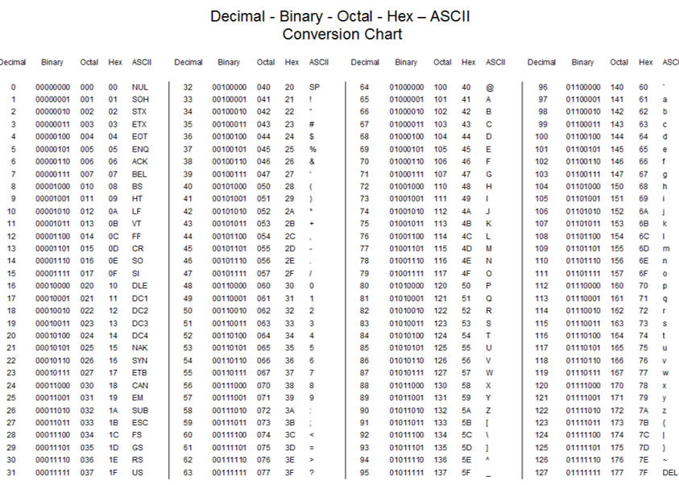

### 1.2.2 Problems
    • ASCII only covers 128 characters. Doesn’t cover
        Accented Latin characters
        Greek, Cyrillic, Chinese, Arabic and other alphabets  

### 1.2.3 Solution    
    •  Use a different character set for Greek characters, Chinese characters(E.g.GBK), etc.
    •  This was the solution used in the past

    Problem:
    •  Data in foreign character sets not interpreted correctly from bytes unless the OS is aware of character encoding. (除非操作系统知道字符编码，否则外来字符集中的数据无法从字节中正确解释。)  
  

    在互联网早期，每个国家的文字都对应一个character set；比如中文是GBK； 日文是Shift-JIS，韩文是UHC；每个国家的字符二进制映射方案都不一样，所以以日文存储的文件，在中文OS中打开都是乱码，其原因是中文GBK中没有日文字符。所以为了解决这个问题，引入了双字节编码的Unicode character set，Unicode中包含世界所有国家的文字和符号，这就从根本上解决了乱码的问题。


## 1.3 Character Sets:Unicode
### 1.3.1 Character Sets：Unicode 
    •  Unicode was devised as a consistent way to encode most characters used in worldwide languages  

    •  Unicode character set defines 154,998 characters
        Modern and historic alphabets
        Symbols
        Emojis
        Control and formatting characters
        Enumerations are called code points

    •  Implemented by character encodings
            UTF-8, UTF-16, UTF-32 and others（8，16，32是指一个字符占用多少Bits编码）
            UTF-8 is the dominant standard(主导标准)


### 1.3.2 Encoding：UTF-8（Unicode  Transformation Format- 8 Bits）
|        | Unicode                               | UTF-8                           |
| ------ | ------------------------------------- | ------------------------------- |
| 是什么 | 字符集（charset）                     | 编码方案（encoding）            |
| 干什么 | 给每个字符分配唯一编号（码点 U+XXXX） | 规定如何把码点转成字节存储/传输 |
| 举例   | "中" = U+4E2D，"A" = U+0041           | U+4E2D → 3 字节 E4 B8 AD        |


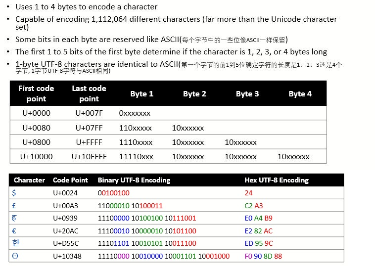   

### 1.3.3 How to convert code point to UTF-8 encoding？
    • Convert hex digits to binary string

    • Determine whether 1-, 2-, 3-, or 4-byte encoding based on code point

    • Insert binary string into x positions in encoding
            Pad with zeroes at front if more x’s than bit
    
 | Bytes | 字符范围(16进制) | 编码方式                            | 第一字节前缀 | 后续字节前缀 |
 | ----- | ---------------- | ----------------------------------- | ------------ | ------------ |
 | 1     | 0 -  7F          | 0xxxxxxx                            | 1个0         | 10           |
 | 2     | 80 - 7FF         | 110xxxxx  10xxxxxx                  | 2个1，1个0   | 10           |
 | 3     | 800 - FFFF       | 1110xxxx 10xxxxxx 10xxxxxx          | 3个1，1个0   | 10           |
 | 4     | >10000           | 11110xxx 10xxxxxx 10xxxxxx 10xxxxxx | 4个1，1个0   | 10           |

**例子**  

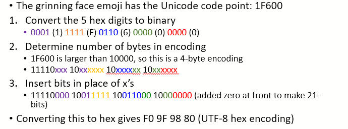

 **练习**     

    • Calculate the binary encodings of the following Unicode code points:

        U+007E (tilde: ~)
        U+00A9 (copyright symbol: ©)
        U+16AB (Aesc rune: ᚫ)
        U+1F911 (money mouth face emoji 🤑)
        

# 2. Other non-numeric data & data structure representations
| Non-numeric data | Data Structures |
| ---------------- | --------------- |
| Booleans         | Arrays          |
| Date/Times       | Records         |
| Text Strings     |                 |

## 2.1 Boolean  
    • Boolean data has two possible values: True (1) or False (0)

    • Ideally represent at 1-bit

    • In practice, stored in larger value
        In C, a signed 32-bit integer where 0 is false, any other value is true
        In Java, a single 16-bit Unicode character
        In Python, stored as Python integer

## 2.2 DateTime
| Type               | Outline                                                                                                                                               | Bytes                          |
| ------------------ | ----------------------------------------------------------------------------------------------------------------------------------------------------- | ------------------------------ |
| Unix epoch(纪元) time    | • number of seconds since Jan 1, 1970<br>• Year 2038 problem<br>• Date will overflow after 19 Jan 2038.<br>• Need to convert to 64- or 128-bit value. | positive 32-bit signed integer |
| Windows epoch(纪元) time | • Number of 100ns intervals since Jan 1, 1601                                                                                                         | unsigned 64-bit integer        |
|Network Time Protocol|• Number of seconds since Jan 1, 1900<br>• Implemented as fixed-point fraction: 32-bits for seconds, 32-bits for fractional part<br>• Overflow on Feb 7, 2036|NTPv4 implements as 128-bit fixed-point fraction<br>64-bits for seconds, 64-bits for fractional part
|

## 2.3 Array
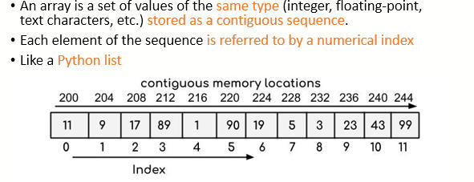

### 2.3.1 Size of an array in memory?  

**Total Memory Size = Size of a element × number of elements**  

    The total memory allocated for an array is equal to:

    E.g. array of 20 ASCII characters = 1 byte (size of ASCII character) × 20 = 20 bytes.
    E.g. array of 30 16-bit integers  = 2 byte (size of 16-bit integer) × 30 = 60 bytes

## 2.4 String
### 2.4.1 String as character arrays
 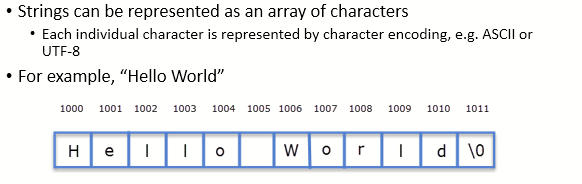

### 2.4.2 How do programming languages represent strings?
|programming languages|Store|bytes used per character|
|---|---|---|
|C|C strings are arrays of ASCII characters terminated with a null(\0) character (size is number of characters in string + 1).| 1|
|Java|Java strings are internally stored as arrays of 16-bit Unicode characters (representing Unicode code points U+0000 to U+FFFF)|2|
|Python|Python 3.3+ strings are internally stored as arrays of Unicode characters (Unicode code points U+0000 to U+007F (ASCII) are stored in one byte)|1, 2, or 4|

## 2.5 Record
### 2.5.1 Outline
    • A record is a set of related data collected under a single name  

    • For example, an address may consist of
        House Name/Number
        Street Name
        Town/City
        County
        Post Code
        Country 

    • Each of these related data items is called a field（字段） and together they form a record(结合在一起形成Record).
        E.g. (University of Leeds, Woodhouse Lane, Leeds, West Yorkshire, LS2 9JT, UK) is an example of an address record.

    • Note that each field can be a different type of data
        Each field can be one of numeric, text data, datetime, etc.

### 2.5.2 How would Record be stored in memory?
    • Most programming languages would store this data contiguously（连续存储）
        • Each field allocated memory to store it(为每个字段分配内存)
        • Each field stored consecutively in memory（Record的所有字段依次存放在连续的地址空间中，中间没有空白)
        • Memory allocated in field order(按声明的顺序存放)  

    • Examples:
        • C structs
        • Objects in object-oriented programming (Python, Java)  

```Python
type element = record{
   name : char[2];              # 2 bytes array of 2 characters
   atomic_number : integer;     # 4 bytes 32 bits 
   atomic_weight : double;      # 8 bytes 64bits 双精度
   metallic : Boolean           # 1 byte
};

# Total Memory size  = sizeof(char) *2 + sizeof(integer) + sizeof(double) + sizeof(Boolean)
```

### 2.5.3 Word Aligned Storage(Word对齐存储)  
    • 理想情况下，我们希望内存中的存储为：
        • 每个字段大小的总和
        • 例如，Element Record为15字节（假设布尔值为1字节）

    • 然而，许多编程语言都会对字段进行Word对齐存储
        • 使系统更容易定位字段的开始和结束
        • 将字段填充word长度字长（或一些整齐的分隔）
        • 例如，在32位字机上，char[3]–3字符数组将额外填充一个字节，使其成为4个字节

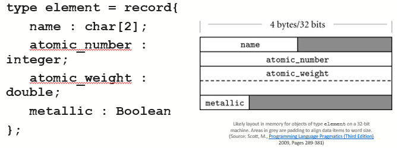    

#### In the C/C++ languages (for a 64-bit machine):
    • A char (1 byte) will be 1-byte aligned.
    • A short (2 bytes) will be 2-byte aligned.
    • An int (4 bytes) will be 4-byte aligned.
    • A long (8 bytes) will be 8-byte aligned.
    • A float (4 bytes) will be 4-byte aligned.
    • A double (8 bytes) will be 8-byte aligned.


#### Exercise
Calculate the memory size in bytes for the following data items:
|||
|---|---|
|An array of 20 integers in C (int)| • an integer = 4 bytes <br> • total = 4*20 = 80 bytes|
The string “Hello, World!” in the C language| • 结尾还要多存储一个null字符<br>• a char = 1 bytes<br>• total = 1 * (12+1) = 13 bytes |
|String “Hello, World!” in the Java language|• 1 char = 2 bytes<br>• total = 2 * 12 = 24 bytes|
|A record with the following field types in order (char, short, float)<br>give 64-bit word aligned length|• Record size = 1 + 2 + 4 == 7 bytes<br>• total(word aligned) = 8 bytes|

# 3. Image representations
## 3.1 Raster Images（光栅图)
### 3.1.1 Outline
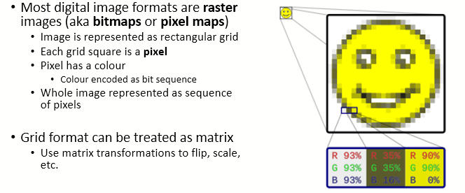  


### 3.1.2 Format
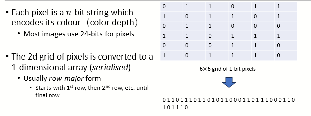

### 3.1.3 Portable Greymap (PGM) Images (便携式灰度图图像)
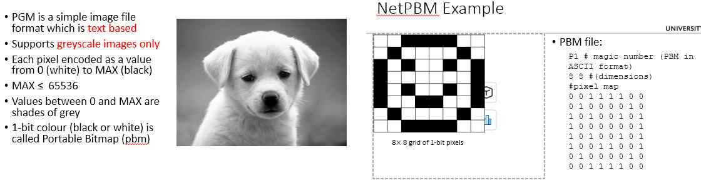  

### 3.1.4 Image Formats and Compression
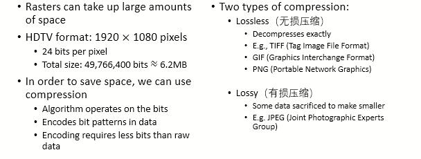  

### 3.1.5 Pixel Colour Depth(像素色彩深度)
    • Each pixel is a coloured square
    • Encode each colour as a set of bits
    • How many bits used gives greater range of different colours: colour depth

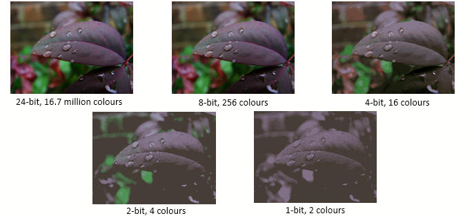  

|Color Depth|Color  Numbers|存储方式|
|---|---|---|
|1 bits| 2| 1: white   0: black|
|4 bits| 16| 16种颜色用0-f编号|
|8 bits| 256| 256种颜色用0-ff编号|
|16 bits|65535|RGB: 555    |
|24 bits|16.7m|RGB: 888    |    

### 3.1.6 RGB Colour Models（显示器)
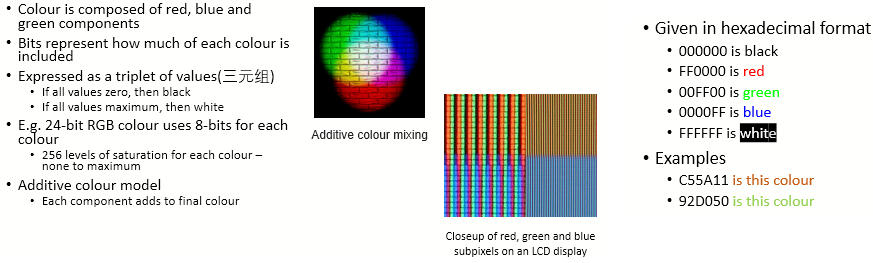 

### 3.1.6 CMYK Colour Models(用于打印机、印刷出版行业)
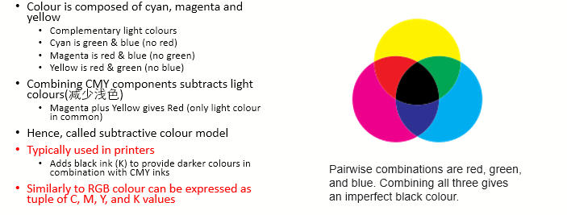

### 3.1.7 HSV Colour Model(色调饱和度亮度色彩模型：用于视频编辑软件)
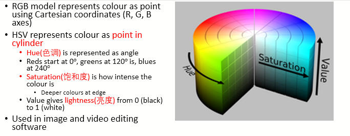  

### 3.3.8 Image Capture(图像捕获)
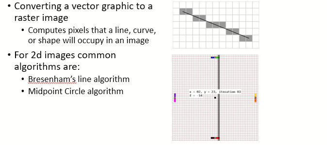  

## 3.2 Vector Images(矢量图)
### 3.2.1 Outline
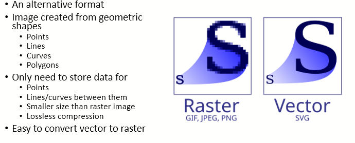  

### 3.2.2 Rasterisation(光栅化)
  

## 3.3 Video/Animation(视频/动画)
    • Video and animation is a series of still images  

    • Each image is a frame(一帧)  

    • The number of frames per second (fps) defines how seamless the sequence seems
        • The frequency of the eye is about 60 Hz, so under 60 fps may seem jerky  

    • Depending on frame resolution and fps, this may require a lot of space to store
        • We can mitigate by interpolation
        • Takes two consecutive frames and calculates difference between them
        • Generates new frame as “midpoint”
        • Can reduce motion blur or jerky video
    
